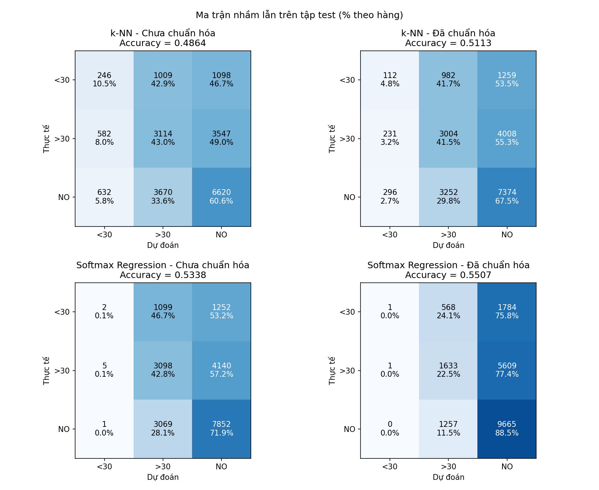

## 3.3. Bảng so sánh kết quả thực nghiệm và ma trận nhầm lẫn

Mục này trình bày kết quả trên **tập test** (20.518 lượt nhập viện) của bài toán đa lớp `y_multi` ∈ {`<30`, `>30`, `NO`}, cho hai mô hình k-NN (bước 07a) và Softmax Regression (bước 07b), mỗi mô hình chạy trên hai phiên bản dữ liệu PCA: chưa chuẩn hóa và đã chuẩn hóa (xem 3.1.6). Số liệu được tính bởi `src/10_evaluation.py` từ các nhãn dự đoán mà 07a, 07b lưu lại, trong lần chạy notebook tổng hợp trên Colab.

### 3.3.1. Bảng so sánh kết quả

| Mô hình | Dữ liệu | Siêu tham số chọn trên validation | Test Accuracy | Macro-F1 | F1 `<30` | F1 `>30` | F1 `NO` |
|---|---|---|---|---|---|---|---|
| k-NN | Chưa chuẩn hóa | $k = 5$ | 0,4864 | **0,3800** | **0,1290** | 0,4142 | 0,5967 |
| k-NN | Đã chuẩn hóa | $k = 9$ | 0,5113 | 0,3719 | 0,0749 | **0,4149** | 0,6259 |
| Softmax Regression | Chưa chuẩn hóa | lr = 0,001; $\lambda = 0$ | 0,5338 | 0,3595 | 0,0017 | 0,4270 | 0,6498 |
| Softmax Regression | Đã chuẩn hóa | lr = 0,5; $\lambda = 0$ | **0,5507** | 0,3323 | 0,0008 | 0,3052 | **0,6909** |
| *Mốc: luôn đoán `NO`* | – | – | *0,5323* | *0,2316* | *0* | *0* | *0,6948* |

*Ghi chú:* macro-F1 là trung bình F1 của ba lớp, không trọng số; đây là độ đo chính để chọn siêu tham số (3.1.6). Dòng mốc được tính từ phân bố nhãn của tập test (10.922 / 20.518 mẫu là `NO`).

### 3.3.2. Ma trận nhầm lẫn

*Hình: ma trận nhầm lẫn trên tập test. Hàng là nhãn thực tế, cột là nhãn dự đoán; mỗi ô ghi số mẫu và tỉ lệ phần trăm theo hàng (tức recall của lớp đó ở đường chéo). File: `output/confusion_matrices.png`; số liệu dạng bảng ở `output/confusion_*.csv`.*

Recall từng lớp (đường chéo ma trận, chia cho tổng hàng):

| Mô hình | Dữ liệu | Recall `<30` (2.353 mẫu) | Recall `>30` (7.243 mẫu) | Recall `NO` (10.922 mẫu) | Số lần đoán `<30` |
|---|---|---|---|---|---|
| k-NN | Chưa chuẩn hóa | 246 (10,5%) | 3.114 (43,0%) | 6.620 (60,6%) | 1.460 |
| k-NN | Đã chuẩn hóa | 112 (4,8%) | 3.004 (41,5%) | 7.374 (67,5%) | 639 |
| Softmax | Chưa chuẩn hóa | 2 (0,1%) | 3.098 (42,8%) | 7.852 (71,9%) | 8 |
| Softmax | Đã chuẩn hóa | 1 (0,0%) | 1.633 (22,5%) | 9.665 (88,5%) | 2 |

### 3.3.3. Nhận xét

**1. Accuracy cao hơn không có nghĩa là mô hình tốt hơn.** Softmax đã chuẩn hóa có accuracy cao nhất (0,5507) nhưng chỉ hơn mốc "luôn đoán `NO`" (0,5323) khoảng 1,8 điểm phần trăm. Ma trận nhầm lẫn cho thấy lý do: mô hình đoán `NO` cho 17.058 / 20.518 mẫu (83,1%), recall lớp `NO` đạt 88,5%, còn lớp `<30` chỉ được đoán 2 lần trên toàn tập test. Ngược lại, k-NN chưa chuẩn hóa có accuracy thấp hơn mốc nhưng macro-F1 cao nhất (0,3800), vì nó phân bố dự đoán đều hơn giữa ba lớp và nhận diện được một phần lớp `<30` (recall 10,5%).

**2. Ảnh hưởng của chuẩn hóa.** Ở cả hai mô hình, chuẩn hóa **tăng accuracy nhưng giảm macro-F1**, tức đẩy mô hình về phía lớp đa số `NO`.
- **k-NN:** accuracy tăng 2,5 điểm (0,4864 → 0,5113) nhưng macro-F1 giảm (0,3800 → 0,3719), recall lớp `<30` giảm hơn một nửa (10,5% → 4,8%). Chuẩn hóa đưa mọi thành phần PCA về cùng phương sai, nên các thành phần cuối (vốn mang ít phương sai, nhiều nhiễu) có tầm ảnh hưởng ngang các thành phần đầu trong khoảng cách Euclid. Validation chọn $k = 9$ thay vì $k = 5$, và $k$ lớn hơn làm luật bỏ phiếu nghiêng về lớp đông mẫu. Lưu ý macro-F1 trên validation của hai phiên bản gần như bằng nhau (0,3899 và 0,3914), nên chênh lệch trên test một phần do việc chọn $k$ trên validation không chuyển hoàn toàn sang test.
- **Softmax:** chuẩn hóa cho phép dùng tốc độ học lớn (0,5) mà vẫn hội tụ, accuracy tăng 1,7 điểm nhưng macro-F1 giảm 2,7 điểm. Trên dữ liệu chưa chuẩn hóa, cấu hình có macro-F1 validation tốt nhất lại là tốc độ học nhỏ nhất (0,001), tức một mô hình chưa hội tụ hết nên còn đoán `>30` nhiều hơn. Vì vậy chênh lệch giữa hai phiên bản của Softmax phản ánh mức độ hội tụ nhiều hơn là bản thân việc chuẩn hóa.

**3. Lớp `<30` là lớp khó nhất.** Đây là lớp quan trọng nhất của bài toán (tái nhập viện trong 30 ngày, 1.1.2) nhưng chỉ chiếm khoảng 11% dữ liệu. Ở cả bốn trường hợp, phần lớn mẫu `<30` bị đoán thành `>30` hoặc `NO` (k-NN chưa chuẩn hóa: 42,9% và 46,7%), và F1 của lớp này không vượt quá 0,13. Hai mô hình đều không dùng trọng số lớp, nên hàm mất mát và luật bỏ phiếu đều ưu tiên các lớp đông mẫu.

**4. Giới hạn chung.** Cả hai mô hình chỉ thấy 60 thành phần PCA, giải thích một phần rất nhỏ tổng phương sai của dữ liệu One-Hot (khoảng 5,63%, xem 3.1.5); nhiều thông tin trong các mã chẩn đoán ICD-9 đã bị bỏ đi. Ranh giới giữa `<30` và `>30` cũng vốn khó phân biệt, vì hai lớp chỉ khác nhau ở thời điểm tái nhập viện.

**5. Hướng cải thiện.** Dùng trọng số lớp (`class_weight` nghịch tần suất) cho Softmax hoặc bỏ phiếu có trọng số cho k-NN; điều chỉnh ngưỡng quyết định cho lớp `<30`; dùng nhiều thành phần PCA hơn hoặc huấn luyện Softmax trực tiếp trên ma trận One-Hot thưa; hoặc chuyển sang bài toán nhị phân (`y_bin`) khi mục tiêu chỉ là phát hiện tái nhập viện.
