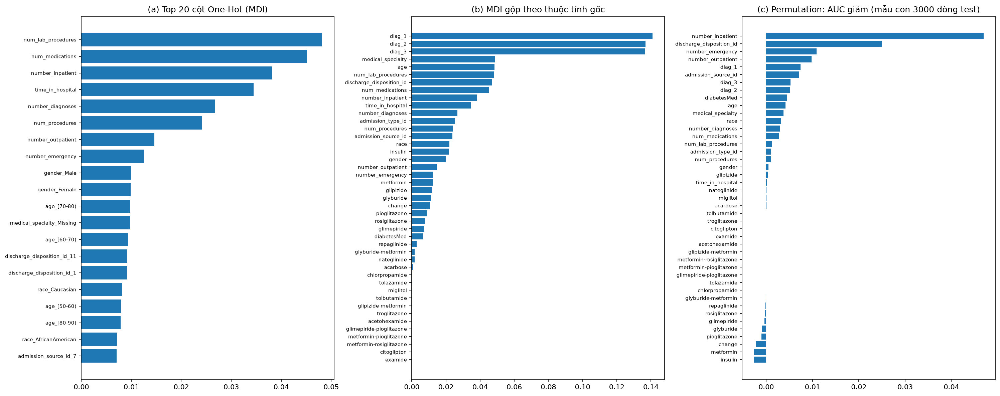

## 3.5. Ảnh hưởng của Class Imbalance và Random Forest trên dữ liệu chưa PCA

Số liệu lấy từ `output/imbalance_*.csv` và `output/rf_raw_*.csv`, do `src/12_imbalance_and_rf_raw.py` sinh ra từ đầu ra của bước 01–06 và kết quả Random Forest trên PCA của Task 1 (`rf_results.csv`, `proba_{val,test}_rf.npy`). Môi trường: scikit-learn 1.6.1, pandas 2.2.3, numpy 2.4.6, `random_state = 42`. Validation là 20% train (phân tầng theo `y_bin`), dùng chung với các mô hình khác; tập test chỉ dùng để báo cáo.

### 3.5.1. Phân bố lớp

| Nhãn | Lớp | Train: số mẫu | Train: tỉ lệ | Test: số mẫu | Test: tỉ lệ |
|---|---|---|---|---|---|
| `y_multi` | `<30` | 8.897 | 11,16% | 2.353 | 11,47% |
| `y_multi` | `>30` | 27.930 | 35,03% | 7.243 | 35,30% |
| `y_multi` | `NO` | 42.899 | 53,81% | 10.922 | 53,23% |
| `y_bin` | `0` | 42.899 | 53,81% | 10.922 | 53,23% |
| `y_bin` | `1` | 36.827 | 46,19% | 9.596 | 46,77% |

`y_multi` mất cân bằng rõ: lớp `<30` chỉ chiếm 11,47% ở test. `y_bin` gần cân bằng. Vì `y_bin = 0` trùng với `y_multi = NO`, mô hình "luôn đoán `NO`" đạt accuracy 53,23% mà không phát hiện được ca nào, nên accuracy đơn lẻ dễ gây hiểu nhầm.

### 3.5.2. Ảnh hưởng đến Random Forest đa lớp (`y_multi`)

Random Forest trên 60 PC với cấu hình tốt nhất của Task 1 (50 cây, `max_depth = None`), huấn luyện trên toàn bộ train, đánh giá trên test:

| Mô hình | Accuracy | Macro-F1 | Recall `<30` | Recall `>30` | Recall `NO` | Số lần đoán `<30` |
|---|---|---|---|---|---|---|
| RF không class_weight | 0,5492 | 0,3587 | 0,0076 | 0,3305 | 0,8108 | 59 / 2.353 |
| RF class_weight=balanced | 0,5502 | 0,3542 | 0,0089 | 0,2993 | 0,8331 | 59 / 2.353 |
| Mốc: luôn đoán NO | 0,5323 | 0,2316 | 0,0000 | 0,0000 | 1,0000 | 0 / 2.353 |

**Nhận xét.** RF hơn mốc "luôn đoán `NO`" 1,69 điểm phần trăm accuracy, nhưng chỉ phát hiện 0,76% ca `<30` (đoán `<30` 59 lần trên 2.353 mẫu thật). Phần lớn macro-F1 đến từ lớp `>30` và `NO`. Dùng `class_weight="balanced"` hầu như không cải thiện: recall `<30` chỉ đổi từ 0,0076 sang 0,0089, số lần đoán `<30` vẫn là 59, và macro-F1 còn thấp hơn (0,3542 so với 0,3587). Với cấu hình cây sâu (`max_depth = None`), mỗi cây khớp gần hết dữ liệu train nên có thể trọng số lớp ít tác động đến dự đoán (giả thuyết này chưa được kiểm chứng riêng). Hạn chế của thí nghiệm: chỉ thử một cấu hình RF và một cách cân bằng, chưa thử lấy mẫu lại (oversampling/undersampling) hay giảm `max_depth` khi dùng trọng số.

Kết nối với k-NN và Softmax (mục 3.3): Softmax đoán `<30` rất ít lần và accuracy chỉ hơn mốc `NO` vài điểm phần trăm (số liệu ở lần chạy chưa loại hai cột hằng số, có thể đổi sau khi chạy lại với bước 05 mới), cùng triệu chứng như RF: mô hình tối ưu cho lớp đa số.

### 3.5.3. Ngưỡng quyết định nhị phân (`y_bin`)

Dùng xác suất của RF PCA (Task 1: 400 cây, `max_depth = 20`), chọn ngưỡng trên validation để tối đa F1 của lớp 1 thay vì 0,5; AUC không đổi vì chỉ đổi ngưỡng:

| Ngưỡng | Accuracy | Precision | Recall | F1 | AUC |
|---|---|---|---|---|---|
| Ngưỡng 0,5 (t = 0,50) | 0,6085 | 0,6010 | 0,4848 | 0,5367 | 0,6537 |
| Ngưỡng chọn trên validation (t = 0,32) | 0,5277 | 0,4974 | 0,9408 | 0,6507 | 0,6537 |

**Nhận xét.** Ngưỡng chọn trên validation là 0,32. Recall tăng từ 0,4848 lên 0,9408 và F1 từ 0,5367 lên 0,6507, nhưng accuracy giảm từ 0,6085 xuống 0,5277 và precision từ 0,6010 xuống 0,4974. Ở ngưỡng thấp như vậy mô hình gần như dự đoán "tái nhập viện" cho hầu hết bệnh nhân, nên F1 tăng chủ yếu vì lớp 1 chiếm gần một nửa dữ liệu chứ không vì mô hình phân biệt tốt hơn (AUC vẫn là 0,6537). Chọn ngưỡng nên dựa vào chi phí thực tế của bỏ sót ca so với cảnh báo nhầm, không chỉ F1.

### 3.5.4. Random Forest trên One-Hot (chưa PCA)

RF 200 cây trên ma trận thưa 2.396 cột One-Hot (bước 04), `max_features = "sqrt"`; `max_depth` chọn trên validation trong {8, 12, 16, 20, `None`} (AUC validation lần lượt 0,6780, 0,6823, 0,6853, 0,6875 và 0,6915: tăng đơn điệu theo độ sâu, cao nhất ở `None`; các giá trị này in ra khi chạy script, không lưu thành csv):

| Dữ liệu | Số cây | `max_depth` | AUC validation | Test Accuracy | Test AUC |
|---|---|---|---|---|---|
| One-Hot (chưa PCA) | 200 | None | 0,6915 | 0,6413 | 0,6957 |
| PCA 60 chiều (Task 1) | 400 | 20 | 0,6542 | 0,6085 | 0,6537 |

**Nhận xét.** RF trên One-Hot tốt hơn RF trên PCA 0,0420 AUC và 3,28 điểm phần trăm accuracy: PCA 60 thành phần chỉ giữ khoảng 5,6% tổng phương sai nên mất thông tin dự báo. Hai cấu hình không hoàn toàn so sánh được (200 cây với `max_depth = None` so với 400 cây với `max_depth = 20`, lưới và phương pháp chọn khác nhau), nhưng khoảng cách 0,0420 đủ lớn để kết luận xu hướng.

### 3.5.5. Độ quan trọng thuộc tính

*Hình: (a) top 20 cột One-Hot theo MDI; (b) MDI gộp theo thuộc tính gốc; (c) permutation importance theo thuộc tính gốc (AUC giảm khi hoán vị cả nhóm cột, trên mẫu 3.000 dòng test, trung bình 3 lần). File: `output/rf_raw_importance.png`.*

Top 10 theo MDI (tổng độ giảm Gini, đã cộng các cột cùng thuộc tính gốc) và theo permutation importance:

| Hạng | Thuộc tính (MDI) | MDI | Thuộc tính (permutation) | AUC giảm |
|---|---|---|---|---|
| 1 | `diag_1` | 14,11% | `number_inpatient` | 0,0470 |
| 2 | `diag_2` | 13,69% | `discharge_disposition_id` | 0,0250 |
| 3 | `diag_3` | 13,67% | `number_emergency` | 0,0109 |
| 4 | `medical_specialty` | 4,86% | `number_outpatient` | 0,0098 |
| 5 | `age` | 4,85% | `diag_1` | 0,0074 |
| 6 | `num_lab_procedures` | 4,82% | `admission_source_id` | 0,0071 |
| 7 | `discharge_disposition_id` | 4,69% | `diag_3` | 0,0053 |
| 8 | `num_medications` | 4,52% | `diag_2` | 0,0051 |
| 9 | `number_inpatient` | 3,82% | `diabetesMed` | 0,0045 |
| 10 | `time_in_hospital` | 3,45% | `age` | 0,0042 |

**Nhận xét.** Theo MDI, ba mã chẩn đoán `diag_1`, `diag_2`, `diag_3` chiếm tổng 41,5% độ quan trọng và đứng đầu. Nhưng MDI thiên vị các thuộc tính có nhiều giá trị: mỗi mã chẩn đoán được One-Hot thành hàng trăm cột, mỗi cột có nhiều cơ hội được chọn để chia nút. Permutation importance (đo trực tiếp mức giảm AUC khi phá thuộc tính) cho bức tranh khác: **`number_inpatient`** là quan trọng nhất (AUC giảm 0,0470), tiếp theo là `discharge_disposition_id` (0,0250), còn `diag_1` chỉ giảm 0,0074. Điều này khớp với trực giác lâm sàng: số lần nhập viện nội trú trước đó và cách xuất viện liên quan trực tiếp đến nguy cơ tái nhập viện. Permutation chạy trên 3.000 dòng với 3 lần lặp nên các giá trị nhỏ (dưới 0,005) có nhiễu và không nên xếp hạng chặt.

Khác với các thành phần PCA (mỗi thành phần là tổ hợp tuyến tính của hàng nghìn cột One-Hot nên không đọc được ý nghĩa), RF trên One-Hot cho phép chỉ ra từng thuộc tính gốc đóng góp bao nhiêu. Đây là lợi thế diễn giải của việc bỏ PCA, ngoài chênh lệch về hiệu quả dự báo ở mục 3.5.4.
