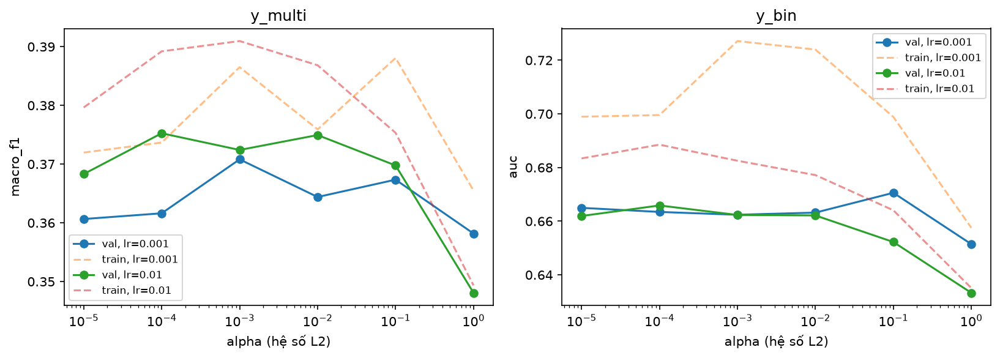

## Kết quả MLP (120-60-20, ReLU) và Aggregate Ensemble

> Chạy trên đầu ra của pipeline 01→06 (train 79.726, test 20.518). Ensemble hiện chỉ gồm MLP và Logistic Regression vì chưa có `proba_*` của Decision Tree và Random Forest (Task 1); chạy lại 09b khi có, kết quả ensemble bên dưới sẽ đổi.

### MLP: chọn siêu tham số trên validation, refit trên toàn bộ train

Quét $\alpha \in \{10^{-5}, \dots, 1\}$ và `learning_rate_init` $\in \{10^{-3}, 10^{-2}\}$ (12 cấu hình mỗi nhãn); chọn theo macro-F1 (`y_multi`) và AUC-ROC (`y_bin`) trên validation. Số liệu: `output/mlp_results.csv`, `output/mlp_sweep.csv`.

| Nhãn | $\alpha$ chọn | `learning_rate_init` | Độ đo chọn | Train | Validation | Test Accuracy | Test (macro-F1 / AUC) |
|---|---|---|---|---|---|---|---|
| `y_multi` | 0,0001 | 0,010 | macro-F1 | 0,3892 | 0,3753 | 0,5647 | 0,3591 |
| `y_bin` | 0,1 | 0,001 | AUC-ROC | 0,6989 | 0,6706 | 0,6212 | 0,6683 |

Mốc "luôn đoán `NO`" trên `y_multi` có accuracy 0,5323, nên MLP chỉ hơn mốc 3,2 điểm phần trăm.

*Hình: train (nét đứt) và validation theo $\alpha$, trục x log. Với `y_bin`, train luôn cao hơn validation: chênh 0,0339 ở $\alpha = 10^{-5}$ (lr = 0,001) và 0,0283 ở $\alpha$ chọn (0,1). Chính quy hóa $L_2$ chỉ giảm nhẹ khoảng cách này; $\alpha = 1$ thì cả hai đường cùng thấp (underfit). File: `output/mlp_alpha_curve.png`, `output/mlp_loss.png`.*

### Aggregate Ensemble (nhị phân)

Trọng số tính trên validation (`output/ensemble_weights.csv`):

| Mô hình | AUC validation | $w$ theo AUC | $w$ đều | $w$ theo AUC − 0,5 |
|---|---|---|---|---|
| MLP | 0,6706 | 0,5149 | 0,5000 | 0,5643 |
| LR | 0,6317 | 0,4851 | 0,5000 | 0,4357 |

Kết quả trên test (`output/ensemble_results.csv`, ngưỡng 0,5):

| Mô hình | AUC | Accuracy | Recall | F1 |
|---|---|---|---|---|
| MLP | 0,6683 | 0,6212 | 0,5950 | 0,5950 |
| LR | 0,6344 | 0,5992 | 0,4631 | 0,5194 |
| **Ensemble, $w \propto$ AUC** | 0,6669 | 0,6240 | 0,5493 | 0,5774 |
| Ensemble, trung bình đều | 0,6665 | 0,6235 | 0,5473 | 0,5762 |
| Ensemble, $w \propto$ AUC − 0,5 | 0,6678 | 0,6236 | 0,5546 | 0,5795 |

**Nhận xét.** Với hai thành viên hiện có, Ensemble ($w \propto$ AUC) đạt AUC 0,6669, thấp hơn mô hình đơn tốt nhất là MLP (0,6683), vì Logistic Regression yếu hơn rõ (0,6344) kéo trung bình xuống. Ba cách đặt trọng số cho AUC test chênh nhau không quá 0,0013. Chưa thể kết luận ensemble có lợi hay không cho đến khi có Decision Tree và Random Forest.
