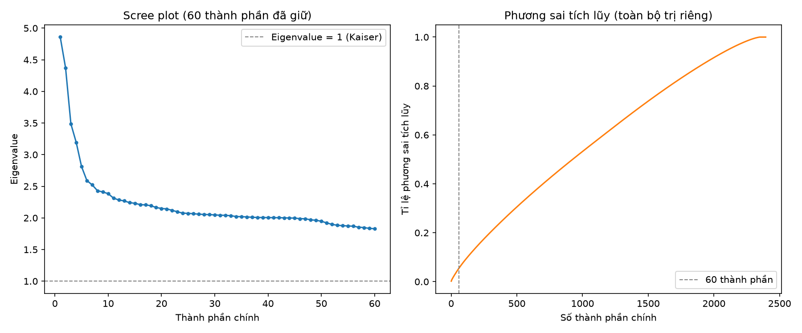

# Kết quả Task 2.3: Chuẩn hóa sau PCA, scree plot và top 5 vector riêng

Chạy trên đầu ra bước 05 (PCA tự cài trên ma trận tương quan); số liệu lấy từ `output/pca_summary.csv`, `output/eigenvalues.csv`, `output/top5_pc_dac_trung.csv`.

- Số đặc trưng đưa vào PCA: **2.394** (2.396 cột One-Hot, bước 05 loại 2 cột hằng số `examide_No`, `citoglipton_No`)
- Số mẫu train: **79.726**
- Số thành phần giữ lại: **60**, giải thích **5,55%** tổng phương sai
- Số thành phần cần để giải thích ≥ 80% phương sai: **1.662/2.394**
- Phương sai giải thích bởi PC1..PC5: PC1 = 0,20%, PC2 = 0,18%, PC3 = 0,15%, PC4 = 0,13%, PC5 = 0,12%

Ma trận One-Hot rất thưa nên phương sai trải đều trên hàng nghìn chiều: 60 thành phần đầu chỉ giữ một phần nhỏ tổng phương sai. Đây là điểm cần lưu ý khi dùng 60 PC làm đầu vào cho các mô hình.

## Top 5 đặc trưng đóng góp lớn nhất cho mỗi PC (trong top 5 PC)

**PC1** (eigenvalue 4,8591, giải thích 0,20% phương sai):
  - `change_No`: trọng số 0,3839
  - `change_Ch`: trọng số -0,3839
  - `diabetesMed_No`: trọng số 0,3618
  - `diabetesMed_Yes`: trọng số -0,3618
  - `insulin_No`: trọng số 0,2756

**PC2** (eigenvalue 4,3718, giải thích 0,18% phương sai):
  - `admission_source_id_7`: trọng số 0,3591
  - `admission_type_id_1`: trọng số 0,3492
  - `admission_source_id_1`: trọng số -0,3417
  - `admission_type_id_3`: trọng số -0,3065
  - `num_lab_procedures`: trọng số 0,1863

**PC3** (eigenvalue 3,4859, giải thích 0,15% phương sai):
  - `discharge_disposition_id_1`: trọng số 0,2724
  - `num_medications`: trọng số -0,2306
  - `time_in_hospital`: trọng số -0,2264
  - `number_diagnoses`: trọng số -0,2252
  - `num_procedures`: trọng số -0,1767

**PC4** (eigenvalue 3,1932, giải thích 0,13% phương sai):
  - `diag_2_648`: trọng số -0,2890
  - `medical_specialty_ObstetricsandGynecology`: trọng số -0,2853
  - `diag_1_648`: trọng số -0,2010
  - `age_[20-30)`: trọng số -0,1788
  - `diag_3_648`: trọng số -0,1676

**PC5** (eigenvalue 2,8114, giải thích 0,12% phương sai):
  - `gender_Male`: trọng số 0,2328
  - `gender_Female`: trọng số -0,2328
  - `num_procedures`: trọng số 0,2291
  - `discharge_disposition_id_1`: trọng số 0,2178
  - `diag_1_414`: trọng số 0,2100
