# Báo cáo bài tập lớn: Dự đoán tái nhập viện ở bệnh nhân đái tháo đường

**Môn:** Máy học Cơ bản và Ứng dụng, HCMUT · **Nhóm 10, lớp L01** (Dũng, Chiến, Sơn)
**Dữ liệu:** UCI *Diabetes 130-US hospitals for years 1999–2008* · **Bài báo tham khảo:** Wang, Stanford CS229

> Quy ước số: dấu phẩy là phần thập phân (0,5507), dấu chấm là phân cách hàng nghìn (20.518).
> Mọi số liệu lấy từ repo (nhánh `Dung`, `Son`, `Chien`, `main`). Nguồn của từng số liệu ghi ở mục [Nguồn dữ liệu trong repo](#10-nguồn-dữ-liệu-trong-repo) và [Tài liệu tham khảo](#11-tài-liệu-tham-khảo).

## Mục lục
1. [Đặt vấn đề](#1-đặt-vấn-đề)
2. [Dữ liệu và khảo sát](#2-dữ-liệu-và-khảo-sát)
3. [Quy trình thực nghiệm](#3-quy-trình-thực-nghiệm)
4. [Tiền xử lý: One-Hot và PCA](#4-tiền-xử-lý-one-hot-và-pca)
5. [Các mô hình](#5-các-mô-hình)
6. [Kết quả bài toán 3 lớp](#6-kết-quả-bài-toán-3-lớp)
7. [Kết quả bài toán nhị phân](#7-kết-quả-bài-toán-nhị-phân)
8. [Mất cân bằng lớp và yếu tố quan trọng](#8-mất-cân-bằng-lớp-và-yếu-tố-quan-trọng)
9. [Kết luận, hạn chế, hướng phát triển](#9-kết-luận-hạn-chế-hướng-phát-triển)
10. [Nguồn dữ liệu trong repo](#10-nguồn-dữ-liệu-trong-repo)
11. [Tài liệu tham khảo](#11-tài-liệu-tham-khảo)

---

## 1. Đặt vấn đề

Đái tháo đường là bệnh mạn tính cần theo dõi liên tục. Bệnh nhân tái nhập viện trong vòng 30 ngày làm tăng chi phí, gây quá tải bệnh viện và thường được xem là chỉ báo chất lượng chăm sóc [1]. Nếu nhận diện được nhóm nguy cơ cao ngay lúc xuất viện, bệnh viện có thể ưu tiên tái khám và can thiệp cho nhóm này.

**Bài toán.** Với đặc trưng **x** của một lượt nhập viện, dự đoán nhãn `readmitted`:

| Nhãn | Ý nghĩa | Bài toán |
|---|---|---|
| `y_multi` ∈ {`<30`, `>30`, `NO`} | tái nhập viện trong 30 ngày / sau 30 ngày / không | đa lớp (3 lớp) |
| `y_bin` ∈ {0, 1} | 1 nếu `<30` hoặc `>30`, 0 nếu `NO` | nhị phân |

**Mục tiêu.** (1) tiền xử lý dữ liệu y tế nhiều giá trị khuyết và biến phân loại bậc cao; (2) xây dựng và so sánh k-NN, Softmax Regression, Decision Tree, Random Forest, MLP và Ensemble; (3) đánh giá bằng độ đo phù hợp với dữ liệu mất cân bằng; (4) phân tích yếu tố liên quan đến nguy cơ tái nhập viện. Báo cáo này **tái hiện và mở rộng** bài báo CS229 của Wang [2].

## 2. Dữ liệu và khảo sát

Bộ dữ liệu do Strack và cộng sự công bố [1][3]: **101.766 lượt nhập viện** của **71.518 bệnh nhân** tại 130 bệnh viện Hoa Kỳ (1999–2008), 50 thuộc tính (nhân khẩu học, thông tin nhập viện, xét nghiệm, 3 mã chẩn đoán ICD-9, 23 loại thuốc, nhãn `readmitted`). Mô tả thuộc tính nằm trong `data/description.pdf`.

### 2.1. Nhãn mất cân bằng

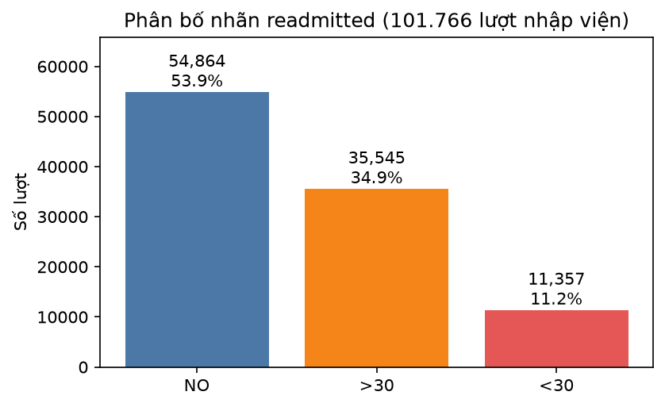

*Hình 1. Phân bố nhãn trên toàn bộ dữ liệu gốc (tự vẽ từ `data/diabetic_data.csv`).*

Lớp `<30`, lớp quan trọng nhất, chỉ chiếm khoảng 11%. Hệ quả: mô hình "luôn đoán `NO`" đã đạt accuracy 0,5323 trên tập test, nên accuracy đơn thuần dễ gây hiểu nhầm. Vì vậy ta chọn mô hình bằng **macro-F1** (đa lớp) và **AUC-ROC** (nhị phân).

### 2.2. Giá trị khuyết

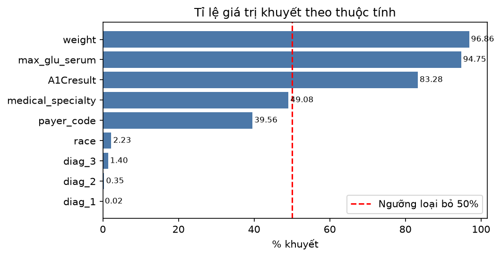

*Hình 2. Tỉ lệ khuyết theo thuộc tính (ký tự `?` được xem là khuyết).*

| Thuộc tính | Khuyết | Xử lý |
|---|---|---|
| `weight` | 96,86% | loại bỏ |
| `max_glu_serum` | 94,75% | loại bỏ |
| `A1Cresult` | 83,28% | loại bỏ |
| `payer_code` | 39,56% | loại bỏ (ID hành chính) |
| `medical_specialty` | 49,08% | giữ, coi khuyết là một loại `Missing` |
| `race`, `diag_3`, `diag_2`, `diag_1` | 2,23% / 1,40% / 0,35% / 0,02% | giữ `race`; bỏ dòng khuyết `diag_*` (1.522 dòng) |

### 2.3. Một vài quan sát từ dữ liệu

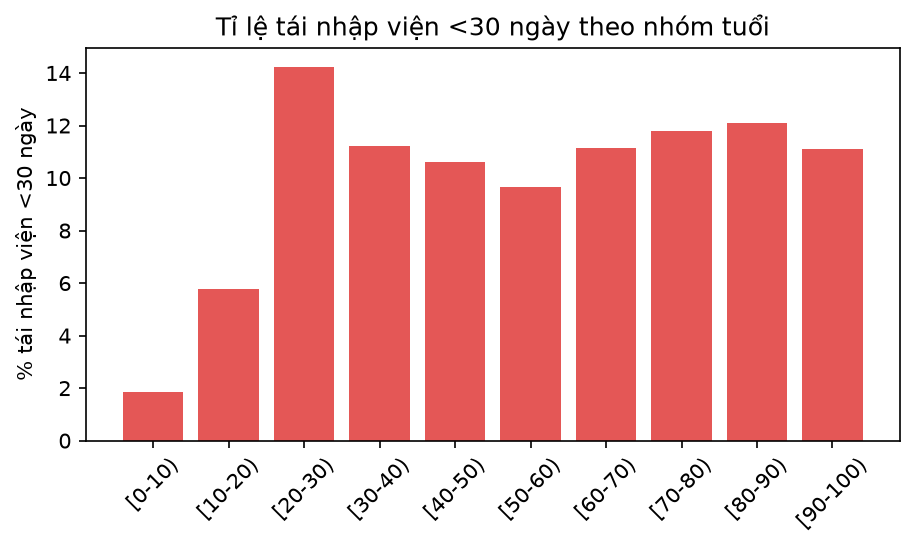

*Hình 3. Tỉ lệ tái nhập viện `<30` theo nhóm tuổi (tự vẽ từ dữ liệu gốc).*

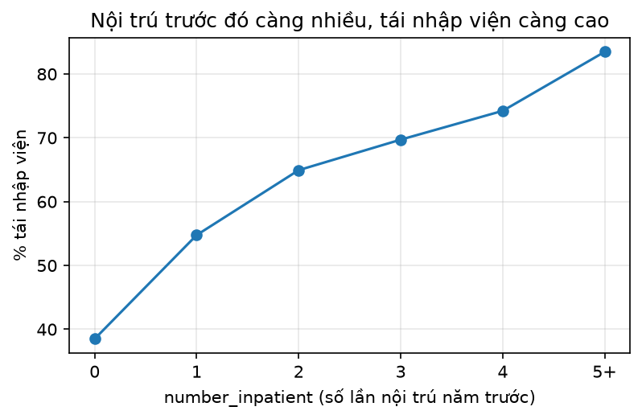

*Hình 4. Tỉ lệ tái nhập viện (bất kể `<30` hay `>30`) tăng mạnh theo `number_inpatient`. Mục 8.3 sẽ cho thấy đây cũng là đặc trưng quan trọng nhất theo permutation importance.*

## 3. Quy trình thực nghiệm

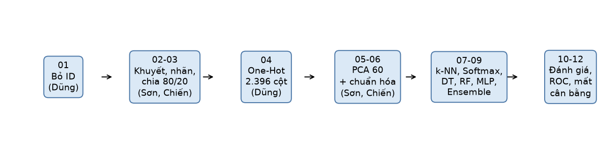

*Hình 5. Pipeline các bước (mỗi bước là một script `src/NN_*.py`, bước sau đọc file do bước trước ghi vào `output/`).*

| Bước | Công việc | Script | Người (nhánh) | Kích thước |
|---|---|---|---|---|
| 01 | Bỏ `encounter_id`, `patient_nbr`, `payer_code` | `01_explore_and_drop_ids.py` | Dũng | 101.766 × 47 |
| 02 | Bỏ cột khuyết > 50% | `02_missing_stats_and_filter.py` | Sơn | 101.766 × 44 |
| 03 | Bỏ dòng khuyết, tạo nhãn, chia 80/20 | `03_data_preprocessing_splitting.py` | Chiến | train 79.726, test 20.518 |
| 04 | One-Hot (fit trên train) | `04_one_hot_encoding.py` | Dũng | × 2.396 cột |
| 05 | PCA 60 thành phần (ma trận tương quan) | `05_pca.py` | Sơn | × 60 |
| 06 | `StandardScaler` sau PCA | `06_feature_scaling_pca_analysis.py` | Chiến | × 60 |
| 07a, 07b | k-NN, Softmax Regression (tự cài bằng numpy) | `07a_knn.py`, `07b_softmax_regression.py` | Dũng | |
| 08a, 08b | Decision Tree, Random Forest | `08a_…`, `08b_…` | Sơn | |
| 09a, 09b | MLP 120-60-20, Ensemble trọng số AUC | `09a_mlp.py`, `09b_ensemble.py` | Chiến | |
| 10 | Accuracy đa lớp, ma trận nhầm lẫn | `10_evaluation.py` | Dũng | |
| 11 | Đánh giá nhị phân, ROC/AUC | `11_binary_evaluation.py` | Sơn | |
| 12 | Mất cân bằng lớp, RF trên One-Hot | `12_imbalance_and_rf_raw.py` | Chiến | |

**Chia dữ liệu.** `StratifiedGroupKFold` (5 phần, lấy 1 phần làm test, `random_state = 42`): phân tầng theo `y_multi` và **nhóm theo `patient_nbr`**, nên một bệnh nhân chỉ xuất hiện ở một tập (tránh rò rỉ giữa train và test; đã kiểm tra bằng `assert`).

| Tập | Số dòng | `NO` | `>30` | `<30` |
|---|---|---|---|---|
| Train | 79.726 | 42.899 (53,81%) | 27.930 (35,03%) | 8.897 (11,16%) |
| Test | 20.518 | 10.922 (53,23%) | 7.243 (35,30%) | 2.353 (11,47%) |

**Quy tắc chống rò rỉ dữ liệu** (áp dụng cho cả nhóm):
- Mọi phép học từ dữ liệu (tập loại One-Hot, trung bình/độ lệch chuẩn, PCA, trọng số ensemble) chỉ **fit trên train**.
- Siêu tham số chọn trên **validation** (20% của train, phân tầng, `random_state = 42`); sau đó huấn luyện lại trên toàn bộ train và **chỉ đánh giá trên test một lần**.
- `random_state = 42` ở mọi nơi; thư viện ghim `scikit-learn==1.6.1`, `pandas==2.2.3`, `numpy==2.4.6` (cách chia train/test phụ thuộc phiên bản scikit-learn).

## 4. Tiền xử lý: One-Hot và PCA

### 4.1. One-Hot Encoding

Mã hóa nhãn 1, 2, 3, … khiến mô hình hiểu nhầm có thứ tự (mã ICD-9 `250` "gần" `251` hơn `401`). One-Hot thay biến $x$ có $K$ giá trị bằng $K$ cột nhị phân $e_k(x)=\mathbb{1}[x=c_k]$; khoảng cách giữa hai loại khác nhau luôn là $\sqrt{2}$ [4].

- 35 biến phân loại (32 thuộc tính chữ + `admission_type_id`, `discharge_disposition_id`, `admission_source_id`, ba mã số thực chất là mã loại), 8 biến số giữ nguyên.
- Giá trị khuyết thành loại riêng `Missing`; loại chỉ có ở test được mã hóa thành toàn 0 (`handle_unknown="ignore"`).
- Kết quả: 8 + 2.388 = **2.396 cột**; ba cột chẩn đoán `diag_1/2/3` chiếm 697 + 716 + 761 = 2.174 cột (~91%). Lưu dạng ma trận thưa vì mỗi dòng chỉ có 35 giá trị 1 trên 2.388 cột.

### 4.2. PCA trên ma trận tương quan

PCA tìm phép chiếu tuyến tính giữ nhiều phương sai nhất [5]: phân rã ma trận hiệp phương sai $C v_j=\lambda_j v_j$, chiếu $Z=\bar X V_m$. Vì cột số (ví dụ `num_lab_procedures` > 100) và cột nhị phân 0/1 khác thang đo, nhóm chuẩn hóa từng cột trước (tương đương PCA trên ma trận tương quan $R=D^{-1/2}CD^{-1/2}$). Hai cột hằng số `examide_No`, `citoglipton_No` bị bỏ, còn **2.394 chiều** → **60 thành phần**.

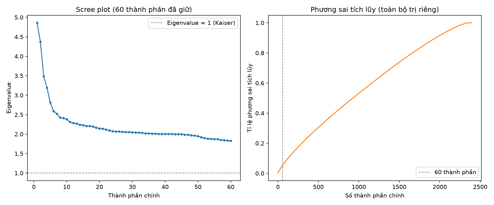

*Hình 6. Phổ trị riêng của PCA (`output/eigenvalues.png`, nhánh `Chien`).*

> **Phát hiện quan trọng.** 60 thành phần đầu chỉ giải thích **khoảng 5,55%** tổng phương sai; cần **2.115** thành phần để đạt 95% và 1.662 để đạt 80%. Khác với mức giảm chiều "hiệu quả" (2.500 → 60) mà bài báo CS229 báo cáo. Nguyên nhân: sau khi chuẩn hóa, cột nhị phân hiếm (mã ICD-9 chỉ vài chục dòng) bị khuếch đại lên cùng mức với cột phổ biến, nên phương sai trải đều trên hàng nghìn hướng gần như không tương quan. Đây là giới hạn then chốt của mọi mô hình huấn luyện trên 60 PC.

## 5. Các mô hình

| Mô hình | Cài đặt | Dữ liệu vào | Siêu tham số quét | Người |
|---|---|---|---|---|
| k-NN | tự cài (numpy), Euclid, bỏ phiếu đa số, tính theo lô 1.024 | 60 PC (chưa / đã chuẩn hóa) | $k\in\{1,3,\dots,51\}$ (26 giá trị) | Dũng |
| Softmax Regression | tự cài (numpy), cross-entropy + $L_2$, gradient descent toàn batch, 500 vòng | 60 PC (chưa / đã chuẩn hóa) | lr ∈ {0,001; 0,01; 0,1; 0,5}, $\lambda$ ∈ {0; 10⁻³; 10⁻²} | Dũng |
| Decision Tree | `sklearn` `DecisionTreeClassifier`, gini | 60 PC chưa chuẩn hóa | `max_depth` 2–20 và `None`, `min_samples_leaf` ∈ {1, 20, 100} | Sơn |
| Random Forest | `sklearn` `RandomForestClassifier`, `max_features=sqrt` | 60 PC chưa chuẩn hóa | `n_estimators` ∈ {50, 100, 200, 400}, `max_depth` ∈ {4,…,20, `None`} | Sơn |
| MLP | `sklearn` `MLPClassifier` (120, 60, 20), ReLU, Adam, early stopping | 60 PC đã chuẩn hóa | $\alpha\in\{10^{-5},\dots,1\}$, lr ∈ {10⁻³, 10⁻²} | Chiến |
| Ensemble | trung bình có trọng số xác suất của DT, RF, MLP, LR | xác suất validation/test | $w_i=\mathrm{AUC}_i/\sum_j\mathrm{AUC}_j$ (AUC trên validation) | Chiến |

**Softmax.** $P(y=c\mid x)=e^{z_c}/\sum_j e^{z_j}$, $z_c=w_c^\top x+b_c$; tối thiểu hóa $J(W)=-\frac1n\sum_i\sum_c\mathbb{1}[y_i=c]\log P(c\mid x_i)+\frac\lambda2\lVert W\rVert_F^2$, gradient theo $w_c$ là $\frac1n\sum_i(P(c\mid x_i)-\mathbb 1[y_i=c])x_i+\lambda w_c$. Hàm lồi nên gradient descent hội tụ về cực tiểu toàn cục. Code có `assert` kiểm tra trên dữ liệu tách được tuyến tính (độ chính xác > 0,95).

**k-NN.** Khoảng cách tính bằng $\lVert q-r\rVert^2=\lVert r\rVert^2-2q\cdot r+\lVert q\rVert^2$ (bỏ số hạng $\lVert q\rVert^2$ vì không đổi thứ tự trong một hàng), lấy $k_{max}=51$ láng giềng một lần rồi dùng chung cho mọi $k$. Có `assert` 1-NN trên chính tập tham chiếu phải trả đúng nhãn.

**Decision Tree / Random Forest.** Chọn chỗ chia theo độ lợi $\text{Gain}(j,t)=\text{Imp}(S)-\frac{|S_L|}{|S|}\text{Imp}(S_L)-\frac{|S_R|}{|S|}\text{Imp}(S_R)$. Random Forest giảm phương sai bằng bagging và chọn ngẫu nhiên $m\approx\sqrt d$ đặc trưng mỗi nút [6].

**MLP và Ensemble.** Cross-entropy cộng $L_2$, lan truyền ngược, Adam [7]. Ensemble theo trọng số AUC lấy ý tưởng từ Hasan và cộng sự [8].

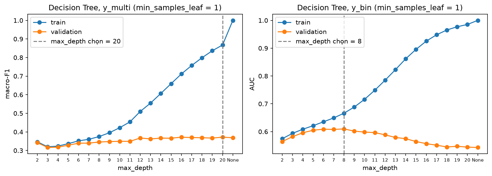

*Hình 7. Decision Tree: điểm train luôn tăng theo độ sâu, còn validation chững lại (đa lớp) hoặc giảm (nhị phân), tức overfit. Độ sâu chọn: 20 cho `y_multi`, 8 cho `y_bin`.*

## 6. Kết quả bài toán 3 lớp

### 6.1. k-NN và Softmax Regression

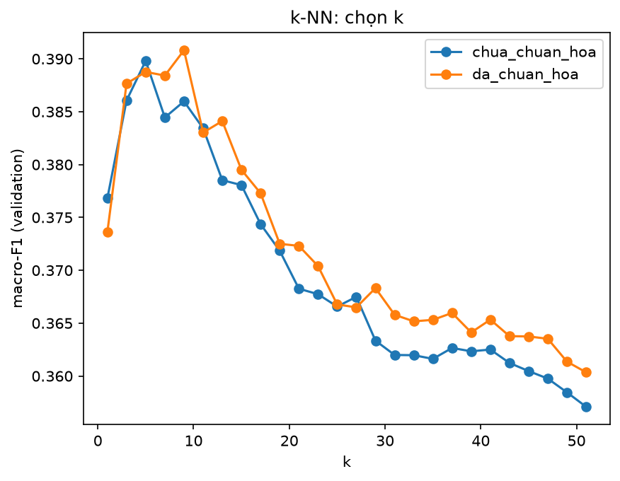

*Hình 8. Chọn $k$ cho k-NN theo macro-F1 trên validation: $k=5$ (chưa chuẩn hóa) và $k=9$ (đã chuẩn hóa). Hai đường gần như trùng nhau (0,3899 và 0,3914).*

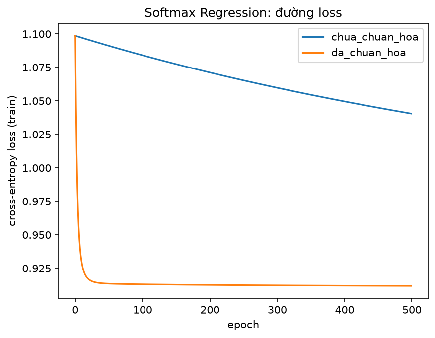

*Hình 9. Đường loss của Softmax. Dữ liệu đã chuẩn hóa hội tụ nhanh với lr = 0,5; dữ liệu chưa chuẩn hóa chỉ dùng được lr = 0,001 nên sau 500 vòng vẫn chưa hội tụ.*

**Bảng 1. Kết quả trên tập test (20.518 mẫu).**

| Mô hình | Dữ liệu | Siêu tham số (chọn trên validation) | Accuracy | Macro-F1 | F1 `<30` | F1 `>30` | F1 `NO` |
|---|---|---|---|---|---|---|---|
| k-NN | Chưa chuẩn hóa | $k=5$ | 0,4864 | **0,3800** | **0,1290** | 0,4142 | 0,5967 |
| k-NN | Đã chuẩn hóa | $k=9$ | 0,5113 | 0,3719 | 0,0749 | **0,4149** | 0,6259 |
| Softmax | Chưa chuẩn hóa | lr = 0,001; $\lambda=0$ | 0,5338 | 0,3595 | 0,0017 | 0,4270 | 0,6498 |
| Softmax | Đã chuẩn hóa | lr = 0,5; $\lambda=0$ | **0,5507** | 0,3323 | 0,0008 | 0,3052 | **0,6909** |
| Decision Tree | 60 PC | depth 20, leaf 1 | 0,4703 | 0,3662 | | | |
| Random Forest | 60 PC | 50 cây, depth `None` | 0,5492 | 0,3587 | | | |
| MLP | 60 PC đã CH | $\alpha=10^{-4}$, lr = 0,01 | 0,5647 | 0,3591 | | | |
| *Mốc: luôn đoán `NO`* | – | – | *0,5323* | *0,2316* | *0* | *0* | *0,6948* |

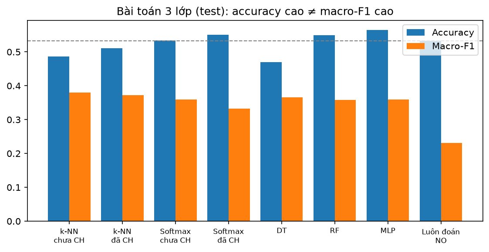

*Hình 10. Accuracy và macro-F1 của các mô hình 3 lớp. Đường nét đứt là mốc 0,5323. "CH" là chuẩn hóa. Tự vẽ từ Bảng 1.*

### 6.2. Ma trận nhầm lẫn

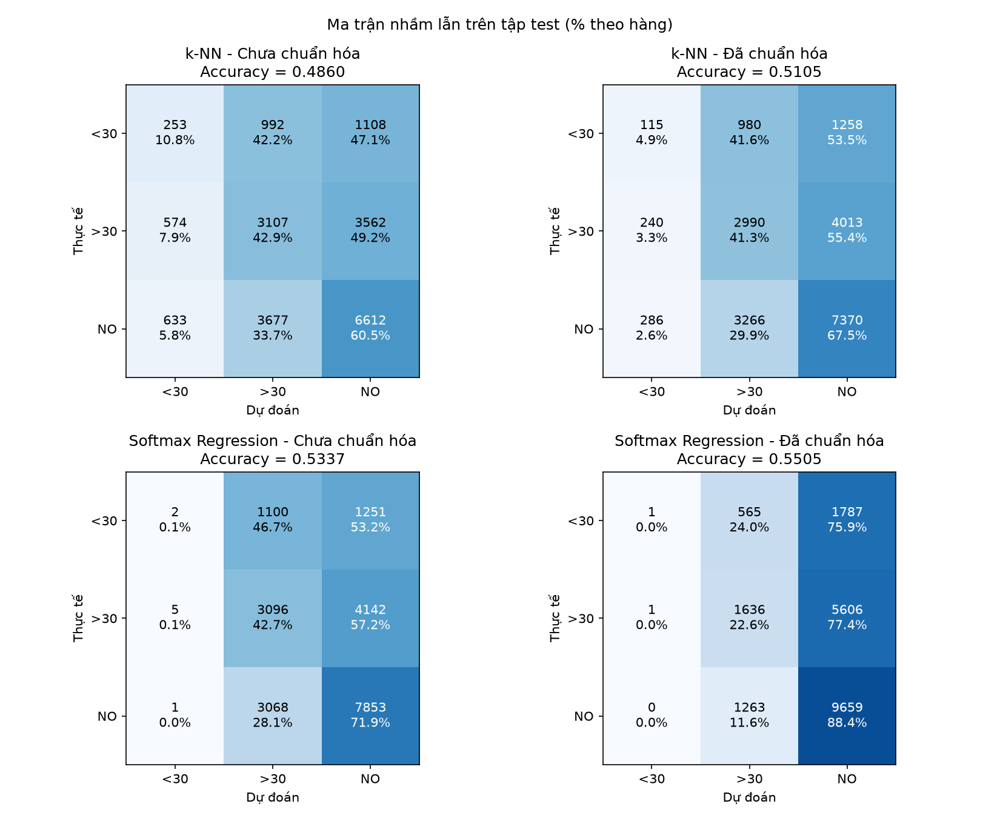

*Hình 11. Ma trận nhầm lẫn (hàng: thực tế, cột: dự đoán, % theo hàng) trích từ notebook tổng hợp `run_local/…Nhóm 10.ipynb`.*

> Lưu ý: hình trên là lần chạy local trong notebook nên lệch nhẹ so với số liệu Colab trong báo cáo (ví dụ accuracy k-NN chưa chuẩn hóa 0,4860 so với 0,4864; Softmax đã chuẩn hóa 0,5505 so với 0,5507). Kết luận không đổi.

### 6.3. Nhận xét

1. **Accuracy cao hơn không có nghĩa là tốt hơn.** Softmax đã chuẩn hóa có accuracy cao nhất (0,5507) nhưng chỉ hơn mốc "luôn đoán `NO`" khoảng 1,8 điểm phần trăm: nó đoán `NO` cho 83,1% mẫu, recall lớp `NO` đạt 88,5%, còn lớp `<30` chỉ được đoán 2 lần. Ngược lại k-NN chưa chuẩn hóa có accuracy thấp hơn mốc nhưng macro-F1 cao nhất (0,3800), vì nó phân bố dự đoán đều hơn và nhận ra một phần lớp `<30` (recall 10,5%).
2. **Chuẩn hóa sau PCA tăng accuracy nhưng giảm macro-F1** ở cả hai mô hình, tức đẩy dự đoán về lớp đa số. Với k-NN, chuẩn hóa đưa các thành phần cuối (ít phương sai, nhiều nhiễu) lên ngang các thành phần đầu trong khoảng cách Euclid. Với Softmax, chênh lệch phản ánh mức độ hội tụ nhiều hơn bản thân chuẩn hóa (Hình 9).
3. **Lớp `<30` là lớp khó nhất**: F1 không vượt quá 0,13 ở mọi mô hình; hai mô hình tự cài không dùng trọng số lớp. Ranh giới `<30` và `>30` cũng vốn khó vì chỉ khác thời điểm tái nhập viện.
4. **Giới hạn chung** là đầu vào 60 PC chỉ giữ 5,55% phương sai (mục 4.2).

## 7. Kết quả bài toán nhị phân

Mỗi mô hình dùng cấu hình tối ưu trên validation (AUC), huấn luyện lại trên toàn bộ train, đánh giá trên test với ngưỡng 0,5.

**Bảng 2. Kết quả nhị phân trên test.** (Precision, Recall, F1 tính cho lớp 1 = tái nhập viện.)

| Mô hình | Accuracy | AUC-ROC | Precision | Recall | F1 |
|---|---|---|---|---|---|
| MLP | 0,6212 | 0,6683 | 0,5950 | 0,5950 | 0,5950 |
| Ensemble (trọng số AUC) | 0,6192 | 0,6644 | 0,6095 | 0,5171 | 0,5595 |
| Random Forest | 0,6085 | 0,6537 | 0,6010 | 0,4848 | 0,5367 |
| Logistic Regression | 0,5992 | 0,6344 | 0,5913 | 0,4631 | 0,5194 |
| Decision Tree | 0,5876 | 0,6140 | 0,5652 | 0,5119 | 0,5372 |
| *Mốc: luôn đoán lớp 0* | 0,5323 | 0,5 | – | 0 | – |

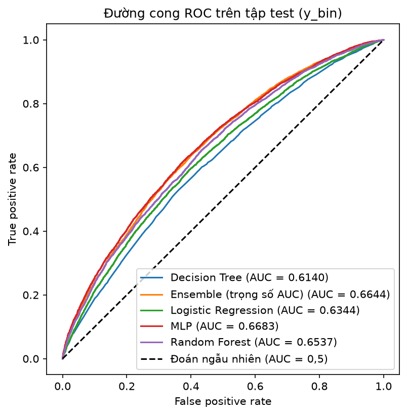

*Hình 12. Đường cong ROC trên tập test (`y_bin`), từ notebook tổng hợp.*

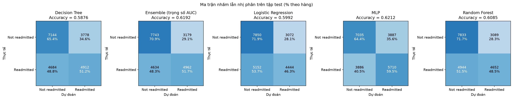

*Hình 13. Ma trận nhầm lẫn nhị phân (% theo hàng).*

**Siêu tham số MLP và trọng số Ensemble.**

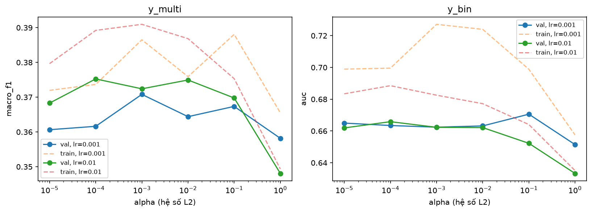

*Hình 14. MLP: điểm train (nét đứt) và validation theo $\alpha$ (trục x log). $\alpha=1$ làm cả hai đường thấp (underfit); train luôn cao hơn validation (nhẹ overfit).*

| Mô hình | AUC validation | $w$ theo AUC | $w$ đều | $w$ theo AUC − 0,5 |
|---|---|---|---|---|
| DT | 0,6162 | 0,2395 | 0,2500 | 0,2028 |
| RF | 0,6542 | 0,2543 | 0,2500 | 0,2693 |
| MLP | 0,6706 | 0,2607 | 0,2500 | 0,2979 |
| LR | 0,6317 | 0,2456 | 0,2500 | 0,2300 |

**Nhận xét.**
- Cả năm mô hình vượt mốc đoán lớp đa số, với AUC 0,6140–0,6683 và accuracy 0,59–0,62, nằm trong khoảng 0,59–0,63 mà bài báo tham khảo báo cáo [2].
- **Ensemble theo AUC không vượt MLP đơn** (0,6644 so với 0,6683). AUC validation của bốn mô hình nằm trong khoảng hẹp nên trọng số xấp xỉ 0,25 mỗi mô hình, ensemble gần như trung bình đơn giản và kéo MLP về phía các mô hình yếu hơn. Ba cách đặt trọng số cho AUC test chênh nhau không quá 0,0023.
- Decision Tree đơn kém nhất (overfit); Random Forest gộp nhiều cây nên tăng AUC thêm 0,04.
- MLP có recall cao nhất (0,5950) nhưng sai 35,6% ca không tái nhập viện. Nếu bỏ sót ca tái nhập viện tốn kém hơn cảnh báo nhầm, nên ưu tiên recall hoặc hạ ngưỡng.

## 8. Mất cân bằng lớp và yếu tố quan trọng

### 8.1. `class_weight` và ngưỡng quyết định

| Mô hình (RF 60 PC, 3 lớp) | Accuracy | Macro-F1 | Recall `<30` | Số lần đoán `<30` |
|---|---|---|---|---|
| RF không `class_weight` | 0,5492 | 0,3587 | 0,0076 | 59 / 2.353 |
| RF `class_weight=balanced` | 0,5502 | 0,3542 | 0,0089 | 59 / 2.353 |
| Mốc: luôn đoán `NO` | 0,5323 | 0,2316 | 0 | 0 |

`class_weight="balanced"` hầu như không cải thiện. Chưa kiểm chứng được nguyên nhân (giả thuyết: cây sâu khớp gần hết train nên trọng số lớp ít tác động). Với `y_bin`, hạ ngưỡng xuống 0,32 (chọn trên validation) đẩy recall từ 0,4848 lên 0,9408 và F1 từ 0,5367 lên 0,6507, nhưng accuracy giảm từ 0,6085 xuống 0,5277 và AUC không đổi (0,6537): mô hình gần như đoán "tái nhập viện" cho tất cả, nên F1 tăng chủ yếu vì lớp 1 chiếm gần một nửa dữ liệu. Chọn ngưỡng cần dựa vào chi phí thực tế.

### 8.2. Bỏ PCA: Random Forest trên One-Hot

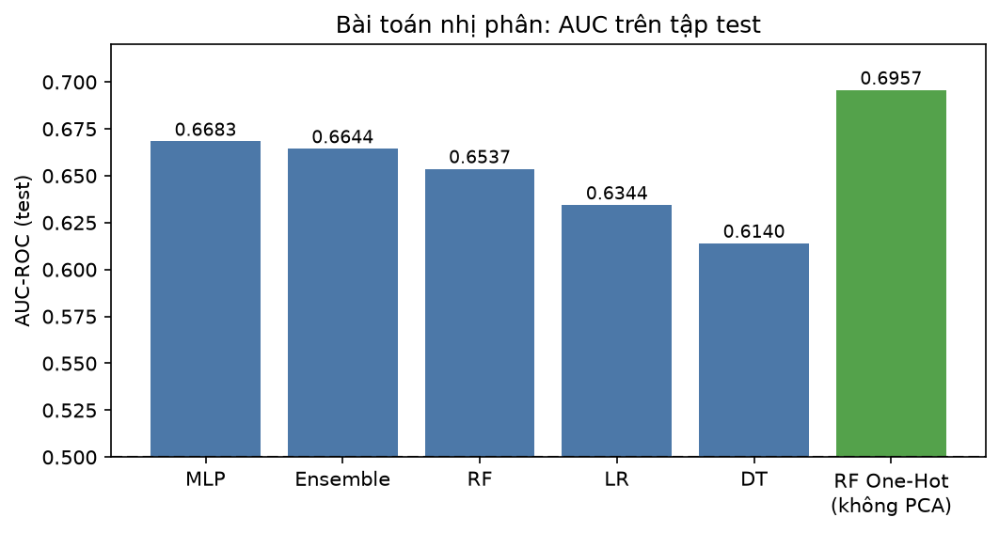

*Hình 15. AUC test của các mô hình nhị phân. Cột xanh lá: RF huấn luyện trực tiếp trên 2.396 cột One-Hot (tự vẽ từ Bảng 2 và `rf_raw_results.csv`).*

| Dữ liệu | Số cây | `max_depth` | AUC validation | Test Accuracy | Test AUC |
|---|---|---|---|---|---|
| One-Hot (chưa PCA) | 200 | `None` | 0,6915 | 0,6413 | 0,6957 |
| PCA 60 chiều | 400 | 20 | 0,6542 | 0,6085 | 0,6537 |

RF trên One-Hot cao hơn 0,0420 AUC và 3,28 điểm phần trăm accuracy, và **tốt hơn mọi mô hình trên PCA**. Điều này khớp với phát hiện ở mục 4.2: PCA 60 chiều làm mất thông tin dự báo. Hai cấu hình không hoàn toàn so sánh được (số cây, `max_depth`, lưới khác nhau), nhưng khoảng cách đủ lớn để kết luận xu hướng.

### 8.3. Thuộc tính nào quan trọng?

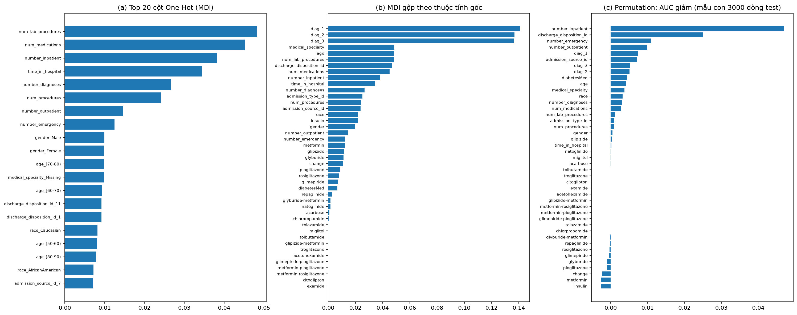

*Hình 16. (a) top 20 cột One-Hot theo MDI; (b) MDI gộp theo thuộc tính gốc; (c) permutation importance theo thuộc tính gốc (`output/rf_raw_importance.png`, nhánh `Chien`).*

| Hạng | Theo MDI | MDI | Theo permutation | AUC giảm |
|---|---|---|---|---|
| 1 | `diag_1` | 14,11% | `number_inpatient` | 0,0470 |
| 2 | `diag_2` | 13,69% | `discharge_disposition_id` | 0,0250 |
| 3 | `diag_3` | 13,67% | `number_emergency` | 0,0109 |
| 4 | `medical_specialty` | 4,86% | `number_outpatient` | 0,0098 |
| 5 | `age` | 4,85% | `diag_1` | 0,0074 |

MDI thiên vị thuộc tính có nhiều giá trị (mỗi mã chẩn đoán thành hàng trăm cột One-Hot) nên đặt ba mã chẩn đoán ở đầu (tổng 41,5%). **Permutation importance** đáng tin hơn: `number_inpatient` (số lần nội trú trước đó) và `discharge_disposition_id` (cách xuất viện) quan trọng nhất, khớp trực giác lâm sàng và Hình 4. Permutation chạy trên 3.000 dòng, 3 lần lặp nên giá trị dưới 0,005 có nhiễu, không nên xếp hạng chặt.

## 9. Kết luận, hạn chế, hướng phát triển

**Kết luận.**
1. Bài toán khó: dù thử k-NN, Softmax, cây, rừng, MLP và ensemble, kết quả vẫn khiêm tốn (3 lớp: macro-F1 ≤ 0,38; nhị phân: AUC ≤ 0,70), phù hợp với bài báo tham khảo [2].
2. Trên bài toán 3 lớp, **accuracy gây hiểu nhầm**: mô hình tốt nhất theo accuracy chỉ hơn mốc 1,8 điểm phần trăm và gần như không nhận ra lớp `<30`.
3. Với bài toán nhị phân, **MLP** tốt nhất trong nhóm dùng PCA (AUC 0,6683); ensemble theo AUC không giúp ích thêm.
4. **PCA 60 chiều là điểm nghẽn**: giữ 5,55% phương sai; RF trên One-Hot chưa PCA đạt AUC 0,6957, cao nhất toàn bộ thí nghiệm, đồng thời cho phép diễn giải thuộc tính gốc.
5. `number_inpatient` và `discharge_disposition_id` là các yếu tố liên quan mạnh nhất đến tái nhập viện.

**Hạn chế.**
- Dữ liệu 1999–2008, chỉ một chiều thời gian, không có thông tin sau xuất viện.
- Mọi mô hình dùng ngưỡng 0,5 (trừ thí nghiệm ngưỡng); chưa lấy mẫu lại (over/undersampling).
- So sánh RF One-Hot với RF PCA chưa cùng lưới siêu tham số.
- Chưa chạy các mô hình khác (k-NN, MLP...) trực tiếp trên One-Hot.
- Số liệu phụ thuộc phiên bản thư viện; lần chạy local có sai khác nhỏ so với Colab (xem mục 6.2).

**Hướng phát triển.** Softmax / MLP huấn luyện trực tiếp trên ma trận One-Hot thưa; gom nhóm mã ICD-9 theo nhóm bệnh trước khi One-Hot để giảm chiều mà vẫn giữ ý nghĩa; `class_weight` hoặc lấy mẫu lại kết hợp chọn ngưỡng theo chi phí; gradient boosting.

## 10. Nguồn dữ liệu trong repo

| Nội dung | Vị trí |
|---|---|
| Dữ liệu gốc, mô tả thuộc tính | `data/diabetic_data.csv`, `data/description.pdf` (nhánh `main`) |
| Bài báo tham khảo (bản scan) | `Predicting diabetes health outcomes using a variety of models.pdf` |
| Code bước 01, 04, 07a, 07b, 10 | `src/` (nhánh `Dung`) |
| Code bước 02, 05, 08a, 08b, 11 | nhánh `origin/Son` |
| Code bước 03, 06, 09a, 09b, 12 | nhánh `origin/Chien` |
| Báo cáo từng phần (Markdown) | `output/*.md` (các mục 1.1, 1.2, 2.1, 2.2, 3.1–3.5) |
| Notebook chạy toàn bộ pipeline | `run_local/261 - MHCBVUD - L01 - Nhóm 10.ipynb` (nhánh `main`) |
| Hình 1–4, 7 (cây), 10, 15 | tự vẽ lại từ dữ liệu gốc và các bảng kết quả (`report/figures/`) |
| Hình 6, 14, 16 | `output/*.png` nhánh `origin/Chien` |
| Hình 8, 9, 11, 12, 13 | trích từ output đã lưu trong notebook trên `main` |

Một số điểm cần lưu ý khi đối chiếu với repo: file `CLAUDE.md` mô tả ensemble gồm LR, RF, GB, MLP, nhưng báo cáo 3.2 và kết quả thực tế dùng **DT, RF, MLP, LR**; báo cáo trong bài này theo bản thực tế. Các file `output/*.npy`, `*.csv` sinh ra khi chạy pipeline không có trên nhánh `Dung` nên cần chạy notebook để tái tạo.

## 11. Tài liệu tham khảo

[1] B. Strack, J. P. DeShazo, C. Gennings, J. L. Olmo, S. Ventura, K. J. Cios, J. N. Clore. *Impact of HbA1c measurement on hospital readmission rates: Analysis of 70,000 clinical database patient records.* BioMed Research International, 2014, 781670. https://doi.org/10.1155/2014/781670

[2] D. Wang. *Predicting diabetes health outcomes using a variety of models.* Stanford CS229 project report (file `Predicting diabetes health outcomes using a variety of models.pdf` trong repo).

[3] UCI Machine Learning Repository. *Diabetes 130-US hospitals for years 1999–2008.* https://archive.ics.uci.edu/dataset/296/diabetes+130-us+hospitals+for+years+1999-2008

[4] scikit-learn developers. *OneHotEncoder* và *Preprocessing data.* https://scikit-learn.org/stable/modules/preprocessing.html#encoding-categorical-features

[5] I. T. Jolliffe, J. Cadima. *Principal component analysis: a review and recent developments.* Phil. Trans. R. Soc. A, 374(2065), 2016. https://doi.org/10.1098/rsta.2015.0202

[6] L. Breiman. *Random Forests.* Machine Learning, 45(1):5–32, 2001. https://doi.org/10.1023/A:1010933404324

[7] D. P. Kingma, J. Ba. *Adam: A method for stochastic optimization.* ICLR 2015. https://arxiv.org/abs/1412.6980

[8] Md. K. Hasan, Md. A. Alam, D. Das, E. Hossain, M. Hasan. *Diabetes prediction using ensembling of different machine learning classifiers.* IEEE Access, 8:76516–76531, 2020. https://doi.org/10.1109/ACCESS.2020.2989857

[9] J. J. Khanam, S. Y. Foo. *A comparison of machine learning algorithms for diabetes prediction.* ICT Express, 7(4):432–439, 2021.

[10] T. S. Brisimi et al. *Predicting diabetes-related hospitalizations based on electronic health records.* Statistical Methods in Medical Research, 28(12):3667–3682, 2019.

[11] F. Pedregosa et al. *Scikit-learn: Machine learning in Python.* JMLR, 12:2825–2830, 2011.

[12] C. R. Harris et al. *Array programming with NumPy.* Nature, 585:357–362, 2020.
